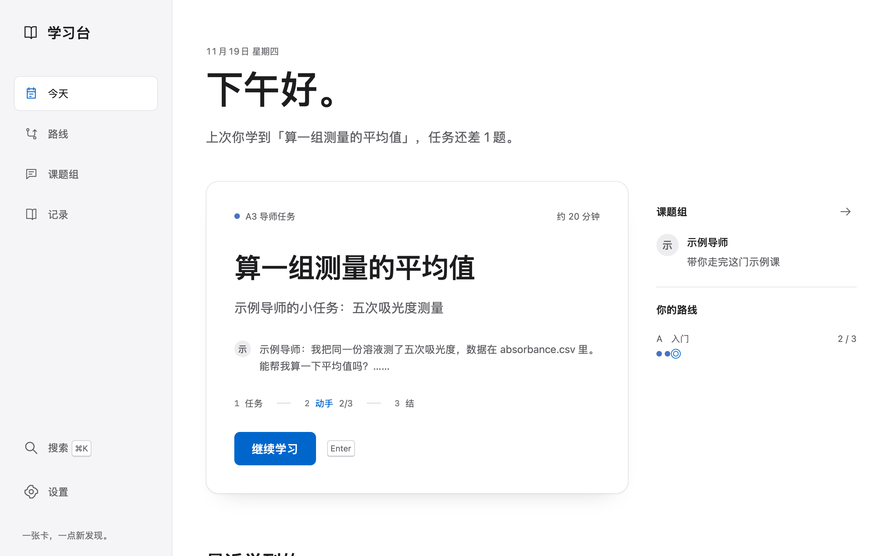
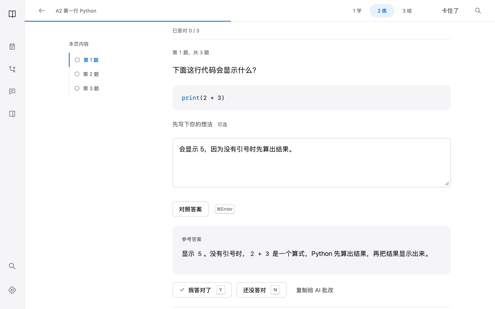
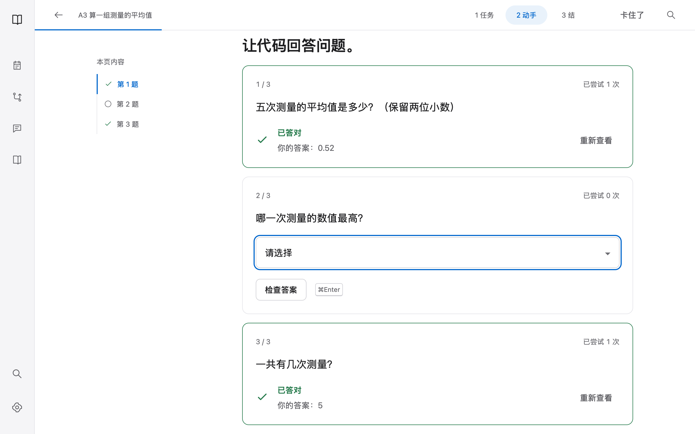
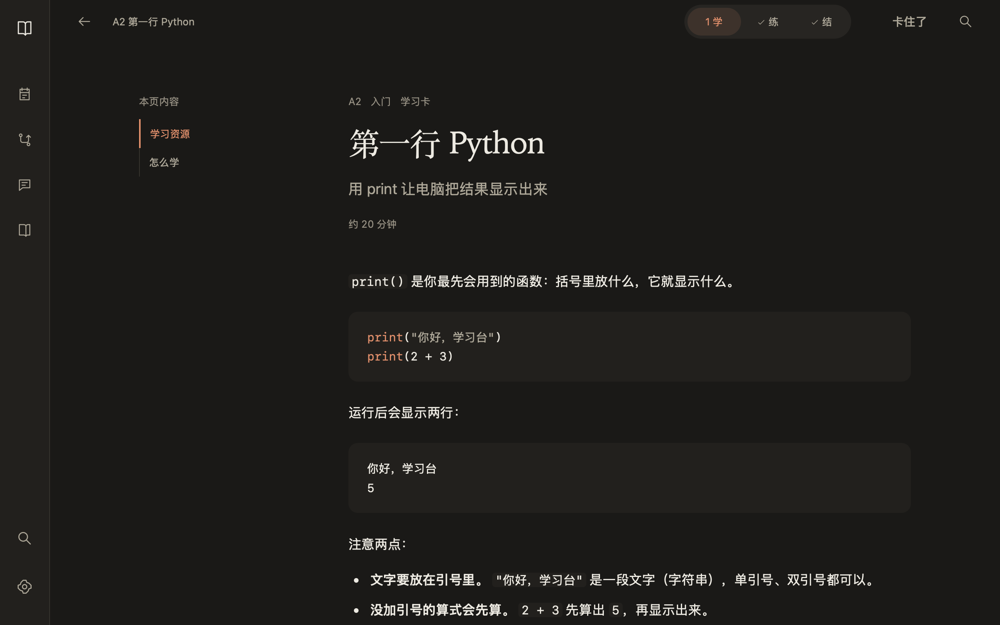

# 学习台 LearningHub

[简体中文](README.md) | English

An offline, local-first study desk. A course is split into cards, and every card goes **learn → practice → wrap up**. Your progress stays on your own computer.

Courses are plain Markdown + YAML files that you can write yourself or have an AI write to the format. The app takes care of the unlocking order, self-check questions, small data tasks with automatic grading, and a "what to study today" suggestion. It runs on macOS and Windows. **The interface is in Chinese.**



## Features

- **Offline, nothing to install.** The backend uses only the Python standard library (3.9+). The frontend is plain JavaScript modules, with no framework and no build step. All third-party code is vendored, and nothing is fetched at runtime.
- **Three steps per card.** *Learn* by reading the lesson and resources; *practice* by writing your own answer before revealing the reference; *wrap up* with a one-line takeaway (optional). Cards on a track unlock in order.
- **Data tasks, graded locally.** Tasks come with data files and are checked by the local server; expected answers and locked solutions never reach the page.
- **Typing is never lost.** Every keystroke is kept as a draft before it is saved; saves are atomic and backed up. You are asked to choose only when the same piece of text was changed in two windows.
- **Your records stay local.** Progress, drafts and exports live in the project's `progress/` folder and are never uploaded.
- **macOS and Windows.** A native window on macOS (Swift + WKWebView), or any browser; an Edge app window on Windows.
- **Safe course updates.** Update packages are checked, backed up and applied as a whole; a course the app cannot read is rolled back automatically, and nothing inside a package is ever executed.

| Practice: write your idea, then compare | Tasks: answer with data, graded locally |
|---|---|
|  |  |

Light and dark appearance, with two themes ("clear" and "paper"):



## Getting started

You need Python 3.9 or newer; there is nothing to `pip install`. Click **Code → Download ZIP** on this page and extract the whole folder (or `git clone`), and keep it in a fixed place. The first time you open the app you will see the bundled three-card demo course.

**Windows:** follow [安装说明-Windows.txt](安装说明-Windows.txt) (in Chinese). After installing Python, double-click `安装学习台.cmd`; a "学习台" shortcut appears on the desktop and in the Start menu.

**macOS (desktop app, recommended):** install the Xcode command line tools (`xcode-select --install` in Terminal), then run once in the project folder:

```sh
bash app/macos/build.sh
```

Then open the generated `学习台.app` and keep it in the Dock if you like. The app is compiled on your own Mac with an ad-hoc signature; it is not notarized by Apple. As long as the folder stays, changing courses never needs a rebuild.

**macOS (browser):** double-click `启动学习台.command` in the project folder to open it in your browser. A file downloaded from the internet may be blocked the first time: right-click it and choose Open.

## Writing your own course

1. Write `content/course.yaml` and `content/cards/<track>/<card>.md` following [docs/CONTENT_SPEC.md](docs/CONTENT_SPEC.md) (in Chinese); task data and expected answers go in `data/`. The bundled demo course (`content/`, `data/`) is a minimal complete example.
2. Check the format:

   ```sh
   PYTHONPATH=app/vendor_py python3 tools/validate_content.py
   ```

3. Reload the app. To ship a new version of a course later, pack it as `learning-hub-update-*.zip` and apply it under **设置 → 课程内容 → 检查更新** (Settings → Course content → Check for updates).

## Development

```sh
python3 -B -m unittest discover app/tests
```

- Architecture and module responsibilities: [app/ARCHITECTURE.md](app/ARCHITECTURE.md); user guide (backups, recovery, updates, shortcuts): [app/README.md](app/README.md). Both are in Chinese.
- The tests do not depend on a particular course. To run them against another one: `LEARNING_HUB_TEST_COURSE=<folder with content/ and data/> python3 -B -m unittest discover app/tests`.
- `app/tests/browser_*.py` are optional real-browser tests that need Playwright installed separately (it is not a runtime dependency).
- Frontend code is formatted with Prettier (`app/.prettierrc.json`), used only during development.

Known limitation: on Windows, the background service may keep running for up to about 30 minutes after the window is closed.

## About

This is Miles's first open-source project, built together with AI assistants: the course content was written by Claude, and the program was implemented by Codex and Claude Code. That is why the content format refers to Claude and Codex, but you can just as well write courses by hand. Files such as HANDOFF, WORKLOG and CODEX_BRIEF mentioned in the docs are working documents of the original project and are not part of this repository.

This is a personal project, provided as is. Issues are welcome, but replies may take a while.

## License

The code is released under the MIT License; see [LICENSE](LICENSE). Bundled third-party components (markdown-it, DOMPurify, highlight.js, PyYAML) and the part of the icon based on Lucide keep their own licenses; see [app/THIRD_PARTY_NOTICES.txt](app/THIRD_PARTY_NOTICES.txt). The demo course uses simulated data.
