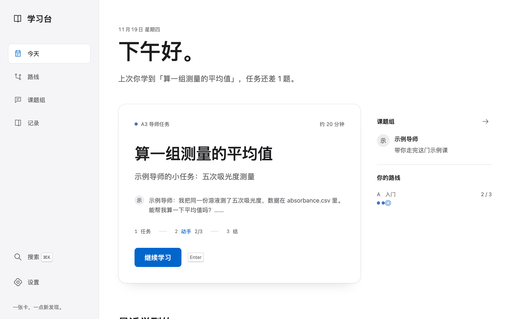
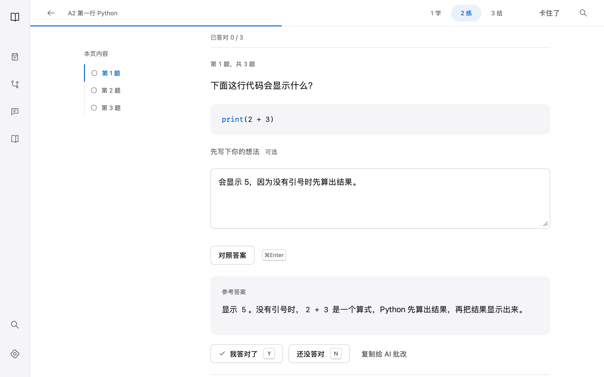
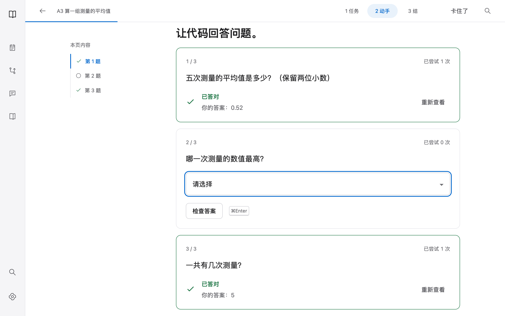
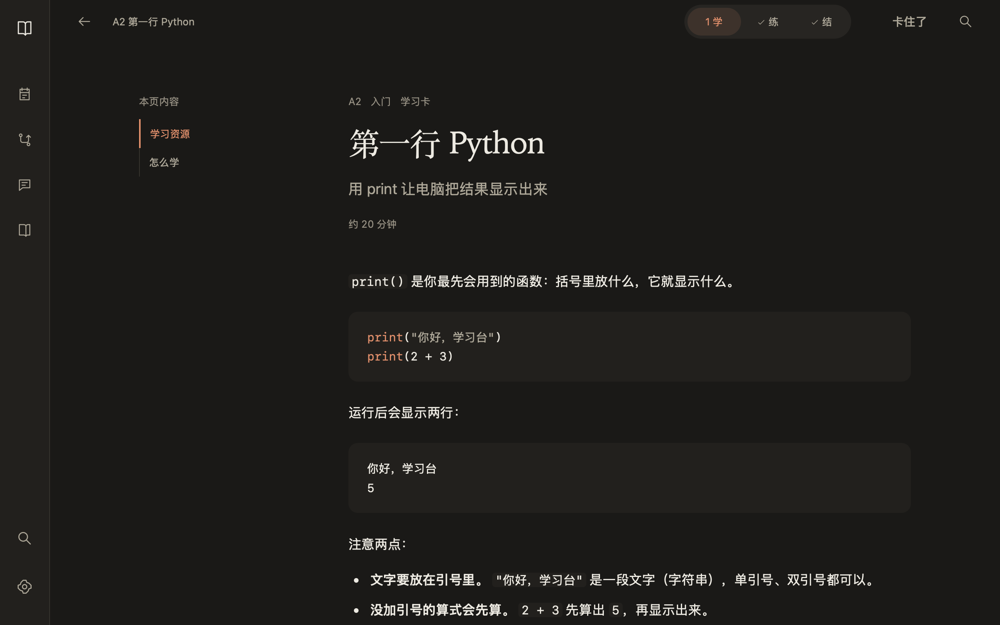

# 学习台 LearningHub

简体中文 | [English](README.en.md)

一个离线运行的个人学习工作台：把一门课拆成一张张卡片，每张卡按 **学 → 练 → 结** 三步走，学习记录只保存在你自己的电脑上。

课程是普通的 Markdown + YAML 文件，可以自己写，也可以让 AI 按格式生成；程序负责解锁顺序、自测、带数据的小任务和自动判题，以及“今天学什么”的推荐。支持 Mac 和 Windows。



## 特点

- **离线、零安装依赖。** 后台只用 Python 标准库（3.9 及以上），前端是原生 JavaScript 模块，没有框架，也没有构建步骤。用到的第三方库都随仓库附带，运行时不联网。
- **卡片三步走。** “学”读讲解和资源，“练”先写自己的想法再对照答案，“结”用一句话写下收获（可选）。同一条线上的卡按顺序解锁。
- **任务卡自动判题。** 任务附带数据文件，答案在本机后台判断，标准答案和未解锁的参考解法不会发到页面上。
- **输入不会丢。** 每个字先存成草稿，再写进学习记录；记录先完整写好再替换，并自动备份。只有同一处文字在两个窗口里都被改过，才会请你选择保留哪一份。
- **记录在本地。** 学习记录、草稿、导出都在项目的 `progress/` 文件夹里，不上传到任何地方。
- **Mac 和 Windows。** Mac 上是原生窗口（Swift + WKWebView），也可以用浏览器；Windows 上用 Edge 的独立窗口。
- **安全的课程更新。** 课程更新包先整体检查、备份，再替换；新课程读不通会自动恢复原样，更新包里的任何代码都不会被执行。

| 练：先写想法，再对照答案 | 任务：用数据回答问题，自动判题 |
|---|---|
|  |  |

还有浅色、深色两种外观，以及“清透”“纸页”两套主题：



## 开始使用

需要 Python 3.9 或更新版本，不需要 `pip install`。先在本页点 **Code → Download ZIP** 并完整解压（或者 `git clone`），把文件夹放在一个固定位置。第一次打开时，你会看到自带的三张卡的示例课程。

**Windows：** 按根目录的 [安装说明-Windows.txt](安装说明-Windows.txt) 操作。装好 Python 后双击 `安装学习台.cmd`，桌面和开始菜单会出现“学习台”快捷方式。

**Mac（桌面应用，推荐）：** 先装好 Xcode 命令行工具（终端执行 `xcode-select --install`），再在项目文件夹里执行一次：

```sh
bash app/macos/build.sh
```

之后双击生成的 `学习台.app`，可以拖到程序坞。这个应用在你自己的电脑上编译，只做了临时签名，没有经过 Apple 公证。只要文件夹还在，以后改课程不用重新编译。

**Mac（浏览器）：** 双击根目录的 `启动学习台.command`，浏览器会打开学习台。从网上下载的文件第一次可能被系统拦下，在文件上点右键 → 打开即可。

## 写自己的课程

1. 按 [docs/CONTENT_SPEC.md](docs/CONTENT_SPEC.md) 的格式写 `content/course.yaml` 和 `content/cards/<线>/<卡>.md`；任务用到的数据和标准答案放在 `data/`。自带的示例课程（`content/`、`data/`）就是一个最小的完整例子。
2. 检查格式：

   ```sh
   PYTHONPATH=app/vendor_py python3 tools/validate_content.py
   ```

3. 刷新学习台。以后发布新版课程，可以打包成 `learning-hub-update-*.zip`，在 **设置 → 课程内容 → 检查更新** 里应用。

## 开发

```sh
python3 -B -m unittest discover app/tests
```

- 架构和各模块的职责：[app/ARCHITECTURE.md](app/ARCHITECTURE.md)；使用说明（备份、恢复、更新、快捷键）：[app/README.md](app/README.md)。
- 测试不依赖具体课程。想换一门课跑测试：`LEARNING_HUB_TEST_COURSE=<含 content/ 与 data/ 的文件夹> python3 -B -m unittest discover app/tests`。
- `app/tests/browser_*.py` 是可选的真浏览器测试，需要自行安装 Playwright（不是运行依赖）。
- 前端代码用 Prettier 排版（`app/.prettierrc.json`），只在开发时使用。

已知限制：Windows 上关闭窗口后，后台最长会再运行约 30 分钟才自动退出。

## 关于

这是 Miles 的第一个开源作品，和 AI 助手一起完成：课程由 Claude 撰写，程序由 Codex 和 Claude Code 实现。所以内容格式说明里会提到 Claude 和 Codex，但你完全可以手写课程。文档里提到的 HANDOFF、WORKLOG、CODEX_BRIEF 等，是原项目写课程和开发时用的工作文档，没有放进这个仓库。

这是个人项目，按现状提供。欢迎提 Issue，但不保证每个都能及时回复。

## 许可

代码以 MIT 许可发布，见 [LICENSE](LICENSE)。随附的第三方组件（markdown-it、DOMPurify、highlight.js、PyYAML）和图标中参考 Lucide 的部分保留各自的许可，见 [app/THIRD_PARTY_NOTICES.txt](app/THIRD_PARTY_NOTICES.txt)。示例课程的数据是模拟的。
